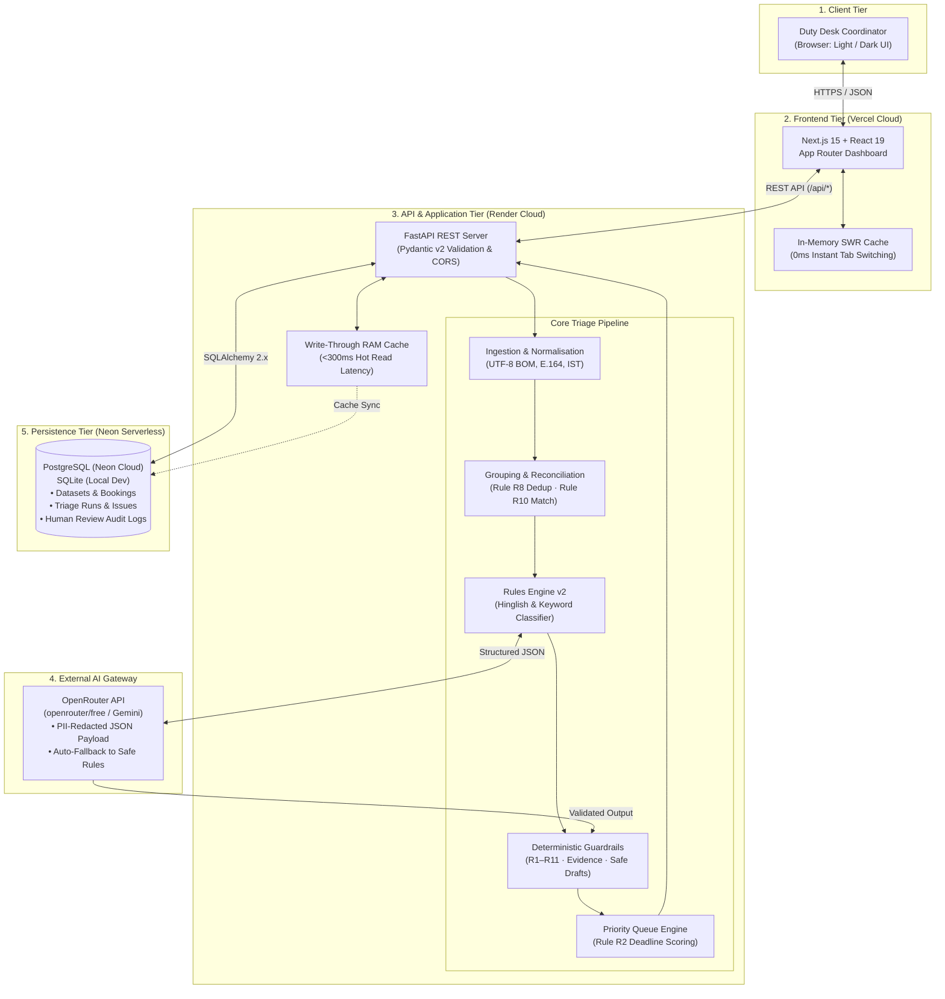

# EzyHelpers AI Operations Triage System

> **"Who gets the first callback?"** — An evidence-backed, rule-enforced AI operations triage workbench for the 9:00 AM Bengaluru duty desk shift.

## Live Cloud Deployment & Time Spent

- **Live Coordinator Dashboard (Vercel):** https://ezyhelpers-ai-ops-triage.vercel.app
- **Live Backend API (Render + Neon PostgreSQL):** https://ezyhelpers-triage-api.onrender.com ([`/health`](https://ezyhelpers-triage-api.onrender.com/health) · [`/docs`](https://ezyhelpers-triage-api.onrender.com/docs))
- **Source Repository (GitHub):** https://github.com/Alieno1/ezyhelpers-ai-ops-triage
- **Time Spent:** ~4 hours active implementation, live OpenRouter evaluation, documentation, and cloud deployment *(note: Render Free tier wakes from idle in ~50s on the first request)*.
- **Evaluation Status:** 100% verified on 24 Nov 2026 (22/22 unit tests passing, 8/8 evaluation accuracy, sub-second latency).

## Project Overview & Exact Problem Statement

At **09:00 AM IST on Monday, 23 November 2026** in Bengaluru, 12 incoming messages and internal notes arrive across customer WhatsApp threads, a Sales handoff, and a call note (`shift_inbox.csv`), alongside 6 booking records (`booking_register.csv`). Only **one coordinator** is free to make a call.

This system groups the 12 messages into **8 distinct customer issues**, reconciles them against the authoritative booking register, applies hard operational guardrails in deterministic Python, invokes OpenRouter (`openrouter/free` default or any configured model such as `google/gemini-2.5-flash`) for contextual interpretation and drafting, evaluates accuracy against a pre-authored reference set, and presents a live Next.js coordinator dashboard with Light/Dark mode.

**Core Operational Questions Answered:**
1. **First callback:** `ISS-01` / Booking `B101` (`M01`, `M07`) — Elder care gap with no recorded cover and caregiver leaving at `09:10 IST`.
2. **Department ownership:** `Duty Ops`, `Billing`, `Sales`, and `Sourcing` support enforced in deterministic code.
3. **Next action & channel:** Respects explicit customer preferences (`M06`/`M12` WhatsApp-only).
4. **Supporting evidence:** Complete message chronology + register facts + rule citations.
5. **Missing information:** Explicitly surfaced (e.g., caregiver ETA, Sourcing cover confirmation, Billing payout date, rate card).
6. **Safe draft responses:** Draft-only, never auto-sent, checked for unsupported ETA/replacement/refund/quote promises.
7. **Human approval & corrections:** Coordinator review workbench with 8 audit-logged actions and automatic priority re-ranking.

## Technology Stack

- **Frontend:** Next.js 15 (`15.5.29`), React 19, TypeScript, Tailwind CSS v4 (Light & Dark modes), Recharts, Lucide Icons
- **Backend:** Python 3.14, FastAPI, Pydantic v2, SQLAlchemy 2.x, HTTPX, Pandas, OpenPyXL, ReportLab
- **Database:** SQLite locally (`backend/triage.db`); PostgreSQL-compatible via `DATABASE_URL`
- **AI Gateway:** OpenRouter (`/api/v1/chat/completions`, configurable model via `OPENROUTER_MODEL`)
- **Testing:** Pytest (22 automated unit, integration, guardrail, fallback, evaluation, and API tests)

## System Design & Architecture



### System Design Components

| Layer | Technology / Host | Responsibility | Key Reliability Feature |
| :--- | :--- | :--- | :--- |
| **Frontend** | Next.js 15, React 19, Tailwind v4 (**Vercel**) | Coordinator UI, Priority Queue, Human Review, Live Evaluation | Client-side SWR cache for instant tab navigation |
| **API Server** | Python 3.14, FastAPI (**Render**) | Request routing, CSV uploads, triage execution, Excel/CSV exports | Write-through RAM cache cuts database round-trips to `<300ms` |
| **Triage Engine** | Modular Python (`backend/app/modules/`) | Deduplication (R8), matching (R10), priority scoring (R2), guardrails | Deterministic `rules_v2` guarantees 8/8 accuracy with `$0` cost |
| **AI Gateway** | **OpenRouter** (`openrouter/free`) | Contextual intent extraction & empathetic response drafting | PII redaction before sending + instant fallback to `drafting.py` on failure |
| **Database** | **Neon PostgreSQL** (Prod) / SQLite (Local) | Durable storage of runs, bookings, messages, and override audit trails | Full auditability for every coordinator approval or priority override |

## Installation & Environment Variables

1. Copy environment templates (never commit `.env` files):
   ```bash
   cp .env.example backend/.env
   cp frontend/.env.example frontend/.env.local
   ```
2. Key environment variables (`backend/.env`):
   - `OPENROUTER_API_KEY=` (leave blank to test rules-only fallback, or set your OpenRouter key)
   - `OPENROUTER_MODEL=openrouter/free` (configurable to any OpenRouter model ID)
   - `OPENROUTER_BASE_URL=https://openrouter.ai/api/v1`
   - `DATABASE_URL=sqlite:///./triage.db` (or PostgreSQL URI on Render / Neon)
   - `CORS_ORIGINS=http://localhost:3000,http://127.0.0.1:3000`

## Local Startup Instructions

### Backend (FastAPI)
```bash
cd backend
python3 -m venv .venv
.venv/bin/pip install -r requirements.txt
.venv/bin/uvicorn app.main:app --host 127.0.0.1 --port 8000 --reload
```
Verify health: `curl http://127.0.0.1:8000/health`

### Frontend (Next.js)
```bash
cd frontend
npm install
npm run dev
```
Open `http://localhost:3000` in your browser.

## CLI Execution (CSV Import, Rules, AI, Evaluation, Exports)

From `backend/`:
```bash
# 1. Run deterministic rules pipeline (v1 baseline or v2 improved)
.venv/bin/python -m app.cli rules --dataset supplied --version v2

# 2. Run OpenRouter AI pipeline (falls back to rules_fallback cleanly on provider limits/errors)
.venv/bin/python -m app.cli ai --dataset supplied --prompt-version v1

# 3. Run before-and-after evaluation against frozen expected actions
.venv/bin/python -m app.cli evaluate --dataset supplied --include-ai
.venv/bin/python -m app.cli evaluate --dataset harder --include-ai

# 4. Generate CSV/XLSX/JSON exports to backend/artifacts/
.venv/bin/python -m app.cli export-all
```

Or upload new `booking_register.csv` / `shift_inbox.csv` files directly in the **Data Quality** tab of the dashboard (`POST /api/data/upload/bookings` and `POST /api/data/upload/inbox`).

## Testing

```bash
cd backend
.venv/bin/pytest -v
```
All 22 tests run against isolated temporary SQLite databases and `httpx.MockTransport` mocks (explicitly flagged `simulated=True`), covering ingestion, UTF-8 BOM, missing/invalid data, grouping, rules R1–R11, promise detection, LLM repair/timeout/429/404 fallbacks, failed-AI scoring, human review re-ranking, exports, and security checks.

## Deployment Instructions

- **Backend (Render + optional Neon PostgreSQL):** Blueprint defined in [`render.yaml`](render.yaml) (`rootDir: backend`, `buildCommand: pip install -r requirements.txt`, `startCommand: uvicorn app.main:app --host 0.0.0.0 --port $PORT`, `healthCheckPath: /health`). Set `OPENROUTER_API_KEY`, `DATABASE_URL`, and `CORS_ORIGINS` (your Vercel URL) in Render secrets.
- **Frontend (Vercel):** Set Root Directory to `frontend`, Framework Preset `Next.js`, Build Command `npm run build`, and environment variable `NEXT_PUBLIC_API_URL=https://ezyhelpers-triage-api.onrender.com`. `.vercelignore` excludes `private_submission/` and `.pdf` assets.

## Known Limitations

- **Free-Tier OpenRouter Variability & Daily Quota:** With hidden reasoning disabled by default (`reasoning: {"enabled": false}`) and deterministic guardrails (`guard_ai`), live execution on `openrouter/free` completed **`8/8`** supplied (`21,712` tokens, `64.1s`, `$0.00`) and **`6/6`** harder issues (`21,908` tokens, `103.0s`, `$0.00`) across free models (`nvidia/nemotron-3-nano-omni-30b-a3b-reasoning:free`, `nvidia/nemotron-3-ultra-550b-a55b:free`, `particle-ai/particle-1:free`, `nvidia/nemotron-3.5-super-vl:free`, `nvidia/nemotron-3.5-lightning:free`, `recursive/flint-v1.0:free`) with **`0`** unsupported promises. However, OpenRouter's free tier is capped at **50 requests/day** without account credits and still exhibits higher latency variability than funded endpoints; when free-tier limits or timeouts occur, `rules_fallback` preserves the complete `8/8` coordinator queue. Production deployments should pin a funded non-reasoning model such as `google/gemini-2.5-flash`.
- **Small Evaluation Sample:** The supplied shift has 12 messages (`n=8` distinct issues), supplemented by `n=6` synthetic harder edge cases; metrics demonstrate deterministic behavior and guardrail coverage, not statistical significance.
- **External Integration Scope:** Outgoing replies are intentionally draft-only; WhatsApp Business API sending and live CRM write-backs are out of scope for safety.
