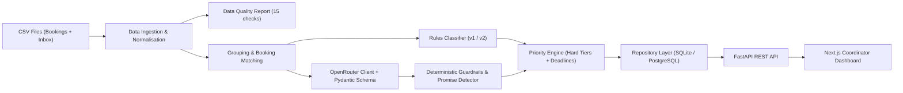
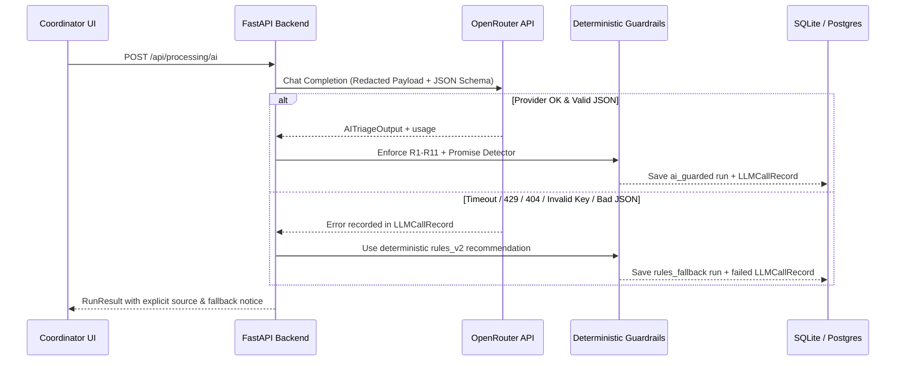

# Technical Architecture

## System Overview

The system separates **deterministic operational facts & business guardrails** (pure Python) from **contextual language interpretation & drafting** (OpenRouter LLM) and **persistence/presentation** (SQLAlchemy + FastAPI + Next.js).

## Component Boundaries & Responsibilities

| Module | File | Responsibility |
|---|---|---|
| Config | `backend/app/config.py` | Environment-driven settings (`OPENROUTER_*`, `DATABASE_URL`, limits). |
| Schemas | `backend/app/schemas.py` | Strict Pydantic v2 contracts across all module boundaries. |
| Normalisation | `backend/app/modules/normalisation.py` | Derived whitespace/quote normalization & PII redaction (`[PHONE]`, `[EMAIL]`). |
| Ingestion | `backend/app/modules/ingestion.py` | UTF-8/BOM decoding, CSV parsing, raw cell preservation, DQ reporting. |
| Matching | `backend/app/modules/matching.py` | Conservative register fact extraction and exact `booking_id` matching. |
| Grouping | `backend/app/modules/grouping.py` | Chronological issue grouping by `booking_id` and `thread_id`. |
| Rules Classifier | `backend/app/modules/rules_classifier.py` | Frozen `v1` English keywords and improved `v2` Hinglish patterns + deadline parsing. |
| Business Rules | `backend/app/modules/business_rules.py` | Deterministic enforcement of rules R1–R11 (owners, actions, channels, missing info). |
| Drafting | `backend/app/modules/drafting.py` | Safe factual draft templates (fallback when AI is unavailable or blocked). |
| Evidence | `backend/app/modules/evidence.py` | Unsupported-promise regex detector + source ID verification. |
| Priority | `backend/app/modules/priority.py` | Hard urgency tiers (`CRITICAL > HIGH > MEDIUM > LOW > NONE`) + deadline tie-break. |
| LLM Client | `backend/app/modules/llm_client.py` | Independent OpenRouter client with timeouts, retries, usage/cost capture. |
| AI Triage | `backend/app/modules/ai_triage.py` | Redacted payload builder, strict JSON schema, validation & single repair retry. |
| Pipeline | `backend/app/pipeline.py` | End-to-end orchestration for `run_rules` and `run_ai` (with `guard_ai`). |
| Evaluation | `backend/app/modules/evaluation.py` | Frozen expected-action scoring (`rules_v1`, `rules_v2`, live AI status). |
| Exports | `backend/app/modules/exports.py` | CSV, multi-sheet XLSX, and Markdown report generation. |
| Persistence | `backend/app/db.py`, `backend/app/repository.py` | SQLAlchemy models & `TriageRepository` decoupling logic from SQLite/Postgres. |
| API Server | `backend/app/main.py` | FastAPI endpoints, CORS, request logging, upload limits, lifespan bootstrap. |

## Data Flow & Fallback Architecture

## API Endpoints

- `GET /health` — Database connectivity, OpenRouter readiness, snapshot time, active run ID.
- `GET /api/overview` — Real-time computed KPIs, first callback summary, urgency/department charts.
- `POST /api/data/upload/bookings` & `POST /api/data/upload/inbox` — Validated CSV import (max 256 KB).
- `POST /api/data/reset` — Reload baseline `supplied` or `harder` source CSVs.
- `GET /api/data/quality-report` — Structured data-quality findings and file summaries.
- `POST /api/processing/rules` / `POST /api/processing/ai` / `POST /api/processing/rerun` — Execute triage pipelines.
- `POST /api/processing/evaluate` & `GET /api/evaluation/latest` — Compare methods against expected actions.
- `GET /api/issues` & `GET /api/issues/{issue_id}` — Filtered/sorted queue & complete issue evidence.
- `PATCH /api/issues/{issue_id}/review` & `GET /api/reviews` — Coordinator edits, overrides & audit trail.
- `GET /api/exports/queue`, `GET /api/exports/evaluation`, `GET /api/exports/issues-report` — CSV/XLSX/MD/JSON downloads.
- `GET /api/model/status` — Safe provider settings (`api_key_configured` boolean only) and call telemetry.

## Database Design

Five SQLAlchemy tables (`datasets`, `runs`, `reviews`, `evaluations`, `llm_calls`) store raw CSV bytes, typed ingest snapshots, immutable rule/AI recommendations alongside mutable `final` coordinator overrides, audit-logged review diffs (`before_json`), and per-call OpenRouter execution metadata.

## Security & Privacy Controls

1. `OPENROUTER_API_KEY` lives strictly in backend environment variables and is never returned by `/api/model/status` or embedded in Next.js bundles.
2. Phone numbers and email addresses are stripped via `redact_pii()` before constructing OpenRouter prompts.
3. Upload handlers enforce `.csv` extension, empty-file rejection, and `MAX_UPLOAD_BYTES` (256 KB default, returning HTTP `413`).
4. CORS origins are explicitly whitelisted via `CORS_ORIGINS`.
5. `private_submission/` is excluded via `.gitignore`, `.vercelignore`, and never mounted in FastAPI static files.

